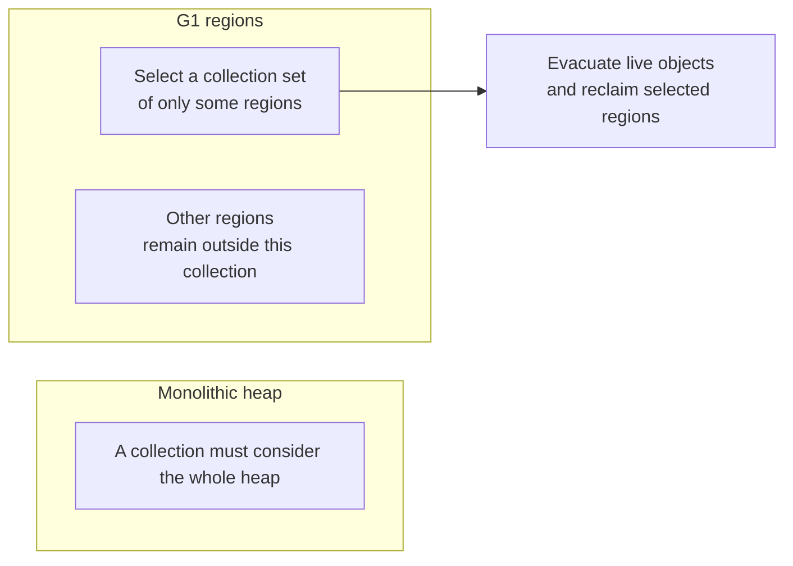
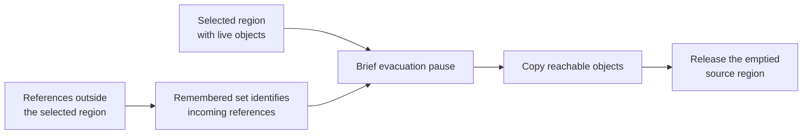
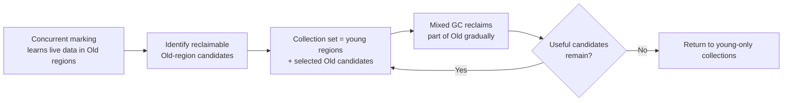

This article covers G1 at three levels: how it works under the hood, how to observe it with JDK 25 unified logging and JFR and how to operate it in containerised environments without falling into tuning traps.

---

## Why G1 exists

Through JDK 8, the dominant collectors were the Parallel GC and CMS.

The ParallelGC is throughput-oriented, stop-the-world for both young and full GC.
The Concurrent mark-sweep is low-pause but prone to fragmentation and also subject to stop-the-world fallback on promotion failure.

G1 was designed to address two problems that those collectors could not solve together:

- Pause time control under larger heaps. Parallel GC pauses scale with live set size. CMS does not compact without a full STW pause.
- Region-based compaction instead of sweeping. CMS leaves free space fragmented; G1 compacts incrementally by evacuating live objects out of selected regions.

G1 became the default collector in JDK 9 and has remained the default. On JDK 25 it is a mature, well-tuned default for most server workloads.



Regions let G1 bound the work of one collection. They do not make every collection pause disappear.

---

## The heap is a set of regions

G1 divides the heap into equal-sized regions. Region size is chosen at startup to produce a few thousand regions<sup><a href="#fn1">[1]</a></sup>.

The heap is the Java object storage area, a single contiguous block of virtual memory that G1 partitions into regions.
A region is the unit of collection: G1 collects and compacts one region at a time.
TLAB stands for Thread-Local Allocation Buffer, a slice of an Eden region reserved for a single thread.
TLABs let threads allocate without synchronising on a shared Eden pointer, which is the main scalability trick for allocation in multithreaded applications.

Each region has a role at any point in time<sup><a href="#fn2">[2]</a></sup>:

- **Eden**: regions where thread-local allocation buffers (TLABs) are allocated.
- **Survivor**: regions holding objects that survived a young collection.
- **Old**: regions holding promoted or directly allocated objects.
- **Free**: uncommitted or reclaimed regions, available for any future role.

After a young collection, the regions that formed the collection set are returned to the free list. They are later acquired for a new role (Eden or Survivor) as needed. No region permanently changes its type; regions cycle through the free list and are reassigned.

A humongous object is an allocation of about half a region or larger. G1 places it directly in contiguous humongous regions rather than in Eden.

### Humongous objects

An object is considered humongous when its size is around half a region or larger. The exact threshold is defined in `g1HeapRegion.cpp`: an object whose size exceeds `region_size / 2` is treated as humongous.

Humongous objects are allocated directly through the main `G1CollectedHeap` allocation path in **contiguous humongous regions**<sup><a href="#fn3">[3]</a></sup>. The allocator reserves a run of free regions large enough to cover the object. These regions are marked with the Humongous type tag and are always considered part of old gen (they bypass Eden and TLABs entirely).

A humongous object is reclaimed when concurrent marking determines it is entirely dead. The regions are then returned to the free list. If the free list is fragmented and no contiguous run is available, the allocation may trigger a young or mixed collection to free up space. There is no in-place compaction of humongous objects; full GC is the only mechanism that defragments the humongous free space.

---

## Allocation and young collections

### Allocation path

Normal (non-humongous) allocations go through TLABs. When a TLAB is exhausted, the thread requests a new one from the Eden set. TLAB sizing is adaptive.

When Eden is full, the VM triggers a young collection<sup><a href="#fn4">[4]</a></sup>.

### Young collection

The collection set (CSet) is the set of regions G1 evacuates in a single pause. Live objects inside the CSet are moved to other regions (copied, not compacted in place). After evacuation, the source regions are returned to the free list and can later be reused for any role. A CSet always includes all Eden regions and may include survivor or old-gen regions depending on the pause type.

A young collection is stop-the-world:

1. The collection set (CSet) is built from all Eden regions and a subset of Survivor regions. Survivor regions with very high live density may be skipped (`G1MixedGCLiveThresholdPercent` also applies to survivor selection, but by default all survivor regions are included).

2. Live objects in the CSet are evacuated (copied) to survivor or old regions depending on their age. Objects that have not reached the tenuring threshold go to Survivor; objects at or above the threshold are promoted to Old<sup><a href="#fn5">[5]</a></sup>.

3. The CSet regions are freed and returned to the free list, available for reassignment as Eden or Survivor in the next cycle.

Evacuation is parallel across worker threads (`-XX:ParallelGCThreads`).

### Remembered sets

A card is a 512-byte block of heap memory, the granularity at which G1 tracks cross-region references. A remembered set (RSet) is a per-region structure that records which cards in other regions might contain references into this region. During a pause, the collector scans only the RSets of the CSet regions, not the entire old generation, to find incoming references.

If G1 scanned the entire old generation for references into young regions, pause time would scale with heap size. Instead, G1 maintains **remembered sets** (RSets): a per-region data structure that records which 512-byte cards in other regions contain references into this region<sup><a href="#fn6">[6]</a></sup>.

Cards are dirtied by the **post-write barrier**: after every reference store, a machine-code barrier (emitted by the JIT) marks the referenced card as dirty<sup><a href="#fn7">[7]</a></sup>.

Dirty cards are processed by **concurrent refinement threads**<sup><a href="#fn8">[8]</a></sup>. These threads scan dirty cards, identify cross-region references and update the RSet of the referenced region. The number of refinement threads is dynamic.

On JDK 25, card sets for adjacent regions that are frequently collected together can be shared under certain conditions (implemented in `g1CardSet.cpp`<sup><a href="#fn9">[9]</a></sup>). This reduces the per-region memory overhead of RSets.

During a young collection, the VM scans only the RSet entries for regions in the CSet. This keeps pause time proportional to the amount of live data in the CSet, not to the total heap size.



The pause makes object relocation safe: G1 has a stable set of roots and incoming references while it copies reachable objects.

### Promotion and tenuring

Each object carries an age in its header. After each young collection, surviving objects age by one. When age reaches `-XX:MaxTenuringThreshold` (default 15 for G1), the object is promoted to old gen.

G1 uses **survivor capacity-based tenuring**: if the total size of objects that would survive exceeds available survivor space, younger objects are tenured early regardless of their age. The age distribution is logged at `gc+age=trace`.

---

## Concurrent marking

G1 uses a concurrent marking cycle to identify old-gen regions with mostly garbage content. The results drive mixed collection selection.

### SATB and the write barrier

Concurrent marking uses a **snapshot-at-the-beginning** (SATB) algorithm<sup><a href="#fn10">[10]</a></sup>. At the start of marking, a logical snapshot of the heap is captured. All objects reachable at that point are treated as live for the duration of the cycle, even if they become unreachable during marking.

Two barriers operate concurrently:

- The **pre-write barrier** runs before a reference field is overwritten. It enqueues the old reference value into the current thread's SATB queue. This ensures that an object that was live at snapshot start remains marked even if the only reference to it is overwritten during marking.

- The **post-write barrier** (described above) dirties cards for RSet maintenance. It is unrelated to SATB.

Each Java thread has a SATB queue. When a queue fills up, it is flushed to a global SATB queue set. Concurrent marking threads drain the global queue set and trace the referenced objects<sup><a href="#fn11">[11]</a></sup>.

A significant change in JDK 25 is the **dual card table** (`g1CardTable`), which separates the RSet-dirtying barrier from the SATB-enqueue barrier at the JIT level. This reduces the overhead of maintaining both in a single barrier, but the effect is workload-specific.

### Marking phases

The Initiating Heap Occupancy Percent (IHOP) is the threshold that triggers concurrent marking. Adaptive IHOP tracks old-gen occupancy growth and marking duration to start the next cycle early enough that concurrent marking finishes well before the heap runs out of evacuation space. If marking starts too late, the VM may fall back to a full GC.

A concurrent marking cycle proceeds as follows:

1. **Concurrent Start** (STW): A young collection that also sets the marking bit on all reachable objects from roots. This pause is slightly larger than a normal young collection because of the root marking work. It is triggered when the Initiating Heap Occupancy (IHO) reaches a threshold set by the adaptive IHOP controller<sup><a href="#fn12">[12]</a></sup>.

2. **Concurrent Mark**: Concurrent threads scan SATB buffers, trace the live object graph and mark discovered objects. Application threads continue running and continue filling SATB buffers. This phase can span multiple young collections.

3. **Concurrent Preclean**: A brief concurrent phase that processes references from classes, JNI and other system roots that were not covered by the initial mark.

4. **Remark** (STW): Drains all remaining SATB buffers, finalises the mark and processes reference objects (soft, weak, phantom, final). This pause is typically comparable to a young collection pause.

5. **Concurrent Rebuild** (sometimes called Concurrent Scrub/Concurrent RSet Rebuild): Concurrently rebuilds the remembered sets for old-gen regions in preparation for mixed GC. In JDK 25 this phase can be adaptive based on how much RSet data changed during marking.

6. **Cleanup** (STW): Identifies regions with zero live objects and immediately reclaims them. Also computes the final live-data percentage for every old-gen region. The results drive mixed collection selection.

The marking cycle can be **aborted** if a young collection is unable to complete evacuation (evacuation failure, see below). A full GC would then be triggered.

Young collections continue to occur normally throughout concurrent marking. The marking cycle adds no additional STW pauses beyond Concurrent Start, Remark and Cleanup.

---

## Mixed collections

Once concurrent marking finishes, the VM has a live-data fraction for each old-gen region. Mixed collections evacuate a subset of those regions alongside the usual young collection work.



Mixed collections avoid turning Old-generation reclamation into one large pause.

### Collection set selection

The mixed CSet is built from two parts<sup><a href="#fn13">[13]</a></sup>:

1. **Young regions**: All Eden regions (same as a normal young collection).
2. **Old-gen candidates**: A subset of old-gen regions selected by **predicted efficiency**: live-data percentage and connectivity (how many other regions reference into the candidate) are used to estimate the amount of garbage collected per millisecond of pause time. Regions with higher predicted efficiency are selected first.

Several parameters constrain the selection:

- `G1MixedGCLiveThresholdPercent` (default 85%): Old regions whose live-data percentage exceeds this threshold are excluded from the CSet entirely. They are considered too dense to evacuate profitably.
- `G1MixedGCCountTarget` (default 8): The target number of mixed GCs to complete after a single marking cycle. The CSet is sized so that the total old-gen evacuation work is spread across approximately this many mixed pauses.
- `G1HeapWastePercent` (default 5%): When the estimated waste in old gen (total free space in regions with mostly dead objects) drops below this percentage of the heap, mixed GCs stop until the next marking cycle provides new candidates.

An evacuation failure occurs when G1 cannot copy certain live objects because no destination space is available or the object is pinned (for example by a JNI critical section). The source region is then left in place and not freed.

Mixed collections are handled by the same `G1YoungCollector` that processes young-only pauses. The evacuation machinery (parallel workers, RSet scanning, card refinement) is identical.

### Evacuation failure and Full GC

If evacuation cannot copy a live object: because no free region is available or the object is pinned (e.g., by a JNI critical section): an **evacuation failure** occurs. The object remains in its original region and the region is marked as failed. Failed regions are not freed after the pause; they accumulate as a retention debt.

When the number of failed regions grows beyond a threshold (or when no forward progress is possible), G1 falls back to a **Full GC** (STW, single-threaded by default, but can use parallel workers via `-XX:+ParallelGC` for Full GC). Full GC compacts the entire heap, including all failed regions. It is a last resort and should be rare under normal operation.

### MaxGCPauseMillis is a goal, not a guarantee

`-XX:MaxGCPauseMillis=200` (the default) is an input to the adaptive policy<sup><a href="#fn14">[14]</a></sup>, not a JVM promise. The policy uses it to estimate how many regions to include in the CSet. If the allocation rate or live-data size exceeds the model's prediction, the resulting pause may exceed the goal. The policy then adjusts and shrinks the CSet for the next cycle.

Setting this flag to an unrealistically low value forces the policy to select very few regions per pause, which can cause the heap to fill faster than it is drained. The result is more frequent or longer pauses, not fewer.

---

## Observing G1 on JDK 25

### Unified GC logging

JDK 9 unified GC logging (JEP 158) provides tag-based log selection. For G1:

```bash
-Xlog:gc*,gc+heap=info,gc+phases=debug,gc+age=trace:file=target/gc.log:time,level,tags:filecount=5,filesize=10m
```

What each tag set shows:

- `gc*`: All GC messages: pause start and end with duration, concurrent phase transitions, region transitions (committed/uncommitted), refinement activity, humongous allocation and freeing events.
- `gc+heap=info`: Eden, Survivor, Old and Humongous region counts and utilisation **before and after** each STW pause. This is the primary signal for sizing (Eden growth, survivor occupancy, old-gen pressure).
- `gc+phases=debug`: Phase-level timing within each STW pause: pre-evacuate, merge heap roots, evacuate, post-evacuate and per-phase contributions to RSet scanning, card handling and reference processing.
- `gc+age=trace`: Age distribution of surviving objects after each young collection: how many bytes per age cohort and how the tenuring threshold was adjusted.

Key pause type identifiers:

| GC log line                      | Meaning                                                 |
| -------------------------------- | ------------------------------------------------------- |
| `Pause Young (Normal)`           | Young-only collection                                   |
| `Pause Young (Concurrent Start)` | Young collection that also initiates concurrent marking |
| `Pause Young (Mixed)`            | Mixed collection (young + selected old regions)         |
| `Concurrent Mark`                | Concurrent tracing phase                                |
| `Concurrent Rebuild`             | Concurrent RSet rebuild                                 |
| `Full GC`                        | Full-heap STW compaction (rare)                         |

### JDK Flight Recorder

JFR is the built-in, low-overhead event system. For G1 observation, start it with:

```bash
-XX:StartFlightRecording=disk=true,dumponexit=true,filename=target/g1.jfr,settings=profile
```

The `profile` settings enable most G1-related events. To verify which events are available, start a recording interactively:

```bash
jcmd <pid> JFR.start name=g1mon duration=60s settings=profile
```

Dump the recording and inspect events:

```bash
jcmd <pid> JFR.dump name=g1mon filename=target/g1.jfr
jfr print --events "jdk.G1HeapSummary,jdk.G1AdaptiveIHOP,jdk.GCPhasePause" target/g1.jfr
```

Key G1 events (availability depends on the JFR configuration via `settings` or `default.jfc` / `profile.jfc`):

- `jdk.G1HeapSummary`: Before and after each STW pause: Eden, Survivor, Old and Humongous region utilisation in bytes and total region count. Use this to track occupancy trends across time.
- `jdk.G1AdaptiveIHOP`: The current IHOP threshold, the actual old-gen occupancy at Concurrent Start and whether the adaptive controller adjusted the threshold. Helps understand why concurrent marking triggered early or late.
- `jdk.GCPhasePause`: Each STW pause with phase name, duration and CPU time. The phase name distinguishes young, mixed, concurrent start and full GC. The CPU time is recorded separately from wall time (compare with `jdk.GCCPUTime`).
- `jdk.GCPhaseConcurrent`: Concurrent phase (mark, rebuild) with wall and CPU time.
- `jdk.GCCPUTime`: Aggregated GC CPU time (user, sys, wall) sampled separately from individual pause events. Useful for isolating GC CPU cost from application CPU.
- `jdk.AllocationRequiringGC`: Records when an allocation request caused a GC to be triggered. The recorded size is the allocation that could not be satisfied, not the total allocation rate. Thread and allocation size are available. This event depends on JFR configuration and may not be enabled by default.

### Reading the signals

Start by examining pause frequency, pause distribution (not just the average) and heap occupancy trends over time. If mixed collections are not keeping up with old-gen occupancy, check the live-data fraction of old-gen candidates. If pauses are exceeding the goal, check whether the allocation rate has changed. If markers are not finishing before the next IHOP threshold is reached, the heap may be too small for the allocation rate.

---

## Operating G1 in microservices and containers

### Do

**Do set explicit memory and CPU limits.** From the demo project:

```bash
docker run --rm --name g1-gc-observability \
  --memory=512m --cpus=1 \
  -v "$PWD/target:/work/target" \
  -v "$PWD/target/g1-gc-observability-1.0.0.jar:/work/app.jar:ro" \
  -w /work \
  eclipse-temurin:25-jdk \
  java -Xms256m -Xmx256m -XX:+UseG1GC \
    -Xlog:gc*:file=target/gc.log:time,level,tags:filecount=5,filesize=10m \
    -Xlog:os+container=trace \
    -XX:StartFlightRecording=disk=true,dumponexit=true,filename=target/g1.jfr,settings=profile \
    -jar app.jar 90
```

The `-Xlog:os+container=trace` flag prints detected cgroup limits at startup.

**Do observe memory with three different tools:**

```bash
# JVM process resident memory (RSS)
docker exec g1-gc-observability sh -c "grep '^VmRSS:' /proc/1/status"

# Cgroup memory charged to the container
docker exec g1-gc-observability cat /sys/fs/cgroup/memory.current

# Container-level metric from the host
docker stats g1-gc-observability --no-stream
```

These three numbers measure different things. `VmRSS` is the process resident set (physical pages mapped by the JVM). `memory.current` inside the container is the total charged to the cgroup (JVM RSS plus page cache, shared libraries and kernel slab). `docker stats` reports a cgroup-based metric that may be adjusted for reclaimable cache. None of them equals `-Xmx`.

**Do use Native Memory Tracking (NMT) for a breakdown of JVM native allocations.** Enable at startup:

```bash
-XX:NativeMemoryTracking=summary
```

Query at runtime:

```bash
docker exec g1-gc-observability jcmd 1 VM.native_memory summary
```

NMT tracks JVM-internal malloc/mmap calls and attributes them to subsystems (heap, class, thread, code, GC, compiler, internal, symbol, etc.). Note: NMT committed values are the JVM's own accounting and do not match RSS or cgroup memory.

### Don't

**Do not set `-Xmn` or `-XX:NewRatio` manually.** G1 adaptively sizes the young generation based on pause time goals and observed allocation rate. A fixed young size overrides this and commonly produces worse results.

**Do not copy tuning flags from other applications.** G1 behaviour depends on the specific allocation rate, object lifetimes and available CPU. Flags from a different workload are unlikely to help.

**Do not draw conclusions from a single pause.** Pauses vary due to JIT compilation, OS scheduling and TLB pressure.

**Do not confuse OOMKilled with OutOfMemoryError.** OOMKilled is the container runtime killing the JVM when the cgroup memory limit is exceeded. It produces no Java heap dump. OutOfMemoryError is the JVM throwing an exception when it cannot satisfy an allocation; it can produce a heap dump via `-XX:+HeapDumpOnOutOfMemoryError`. Only one of the two is a GC tuning problem.

### Investigate before tuning

Before changing any G1 parameter:

1. Check the pause frequency and pause time distribution from GC logs or JFR.
2. Check whether concurrent marking phases are CPU-limited (concurrent threads compete with application threads).
3. Check for humongous allocation patterns that fragment the free list.
4. Check whether concurrent marking completes before the next IHOP is reached. If it does not, the heap may be undersized for the allocation rate.
5. Look at the pause time distribution, not just the average.

G1 tuning is rarely the right response to a performance problem. Most cases diagnosed as "GC tuning" turn out to be allocation rate, object lifetime, or container memory configuration issues.

---

## When G1 is not the right collector

G1 works well when the workload produces a mix of short-lived and longer-lived objects and pause time goals are in a range G1 can meet with its adaptive policy. It is the default for good reason.

G1 may not be ideal when:

- **Pause time targets are sub-millisecond or hard real-time.** G1's stop-the-world pauses are a deliberate design choice. It cannot eliminate them.
- **The heap is very small.** The region and RSet overhead is proportionally more significant.
- **Throughput is the only goal and pauses are acceptable.** Parallel GC (`-XX:+UseParallelGC`) avoids RSet maintenance and concurrent marking overhead.
- **Old-gen garbage barely accumulates.** G1's concurrent marking and mixed GC add complexity without benefit when most objects die young.

ZGC and Shenandoah are concurrent compacting collectors available on JDK 25. Both operate with very low pause times by using different techniques (colored pointers and load barriers for ZGC, forwarding pointers and Brooks pointers for Shenandoah). They can be alternatives when G1's pause profile does not fit the application requirements, but they have their own trade-offs in CPU overhead and memory footprint.

---

## Conclusion

G1 combines region-based compaction, concurrent marking and incremental evacuation to provide predictable pause behaviour across a range of workloads. Its adaptive heuristics mean that most applications need no tuning beyond setting `-Xmx` and a pause time goal.

Understanding the internal mechanisms (regions, remembered sets, SATB, mixed GC selection, evacuation failure) helps in reading GC logs and JFR events correctly. The trap is assuming that G1 tuning is the answer before ruling out allocation rate, object lifetime patterns and container memory configuration.

JDK 25 provides everything needed to diagnose GC behaviour without guessing: unified logging with structured tags, JFR events for heap and pause analysis, NMT for native memory breakdown and container-awareness for cgroup-limited deployments.

---

## References

- [Oracle: G1 GC Tuning Guide][oracle-tuning]
- [Oracle: G1 GC Overview][oracle-overview]
- [Oracle: Java Command Reference][oracle-java-cmd]
- [OpenJDK 25u source (GitHub)][openjdk-25u]
- <a id="fn1"></a>[g1HeapRegion.cpp#L72-L106: Region size computation](https://github.com/openjdk/jdk25u/blob/jdk-25.0.4+1/src/hotspot/share/gc/g1/g1HeapRegion.cpp#L72-L106)
- <a id="fn2"></a>[g1HeapRegionType.hpp#L80-L98: Region type query methods](https://github.com/openjdk/jdk25u/blob/jdk-25.0.4+1/src/hotspot/share/gc/g1/g1HeapRegionType.hpp#L80-L98)
- <a id="fn3"></a>[g1CollectedHeap.cpp#L345-L386: Humongous allocation](https://github.com/openjdk/jdk25u/blob/jdk-25.0.4+1/src/hotspot/share/gc/g1/g1CollectedHeap.cpp#L345-L386)
- <a id="fn4"></a>[g1CollectedHeap.cpp#L410-L442: Allocation slow path](https://github.com/openjdk/jdk25u/blob/jdk-25.0.4+1/src/hotspot/share/gc/g1/g1CollectedHeap.cpp#L410-L442)
- <a id="fn5"></a>[g1YoungCollector.cpp#L510-L530: Young evacuation](https://github.com/openjdk/jdk25u/blob/jdk-25.0.4+1/src/hotspot/share/gc/g1/g1YoungCollector.cpp#L510-L530)
- <a id="fn6"></a>[g1RemSet.cpp#L560-L580: RSet scan](https://github.com/openjdk/jdk25u/blob/jdk-25.0.4+1/src/hotspot/share/gc/g1/g1RemSet.cpp#L560-L580)
- <a id="fn7"></a>[g1BarrierSet.cpp#L65-L75: Post-write barrier](https://github.com/openjdk/jdk25u/blob/jdk-25.0.4+1/src/hotspot/share/gc/g1/g1BarrierSet.cpp#L65-L75)
- <a id="fn8"></a>[g1ConcurrentRefine.cpp#L345-L350: Card refinement](https://github.com/openjdk/jdk25u/blob/jdk-25.0.4+1/src/hotspot/share/gc/g1/g1ConcurrentRefine.cpp#L345-L350)
- <a id="fn9"></a>[g1CardSet.cpp#L230-L280: Card set structure](https://github.com/openjdk/jdk25u/blob/jdk-25.0.4+1/src/hotspot/share/gc/g1/g1CardSet.cpp#L230-L280)
- <a id="fn10"></a>[g1SATBMarkQueueSet.cpp#L55-L75: SATB buffer filter](https://github.com/openjdk/jdk25u/blob/jdk-25.0.4+1/src/hotspot/share/gc/g1/g1SATBMarkQueueSet.cpp#L55-L75)
- <a id="fn11"></a>[g1ConcurrentMark.cpp#L610-L620: Concurrent mark](https://github.com/openjdk/jdk25u/blob/jdk-25.0.4+1/src/hotspot/share/gc/g1/g1ConcurrentMark.cpp#L610-L620)
- <a id="fn12"></a>[g1IHOPControl.cpp#L160-L180: Adaptive IHOP](https://github.com/openjdk/jdk25u/blob/jdk-25.0.4+1/src/hotspot/share/gc/g1/g1IHOPControl.cpp#L160-L180)
- <a id="fn13"></a>[g1CollectionSet.cpp#L545-L650: Mixed candidate selection](https://github.com/openjdk/jdk25u/blob/jdk-25.0.4+1/src/hotspot/share/gc/g1/g1CollectionSet.cpp#L545-L650)
- <a id="fn14"></a>[g1Policy.cpp#L240-L280: Pause-target policy](https://github.com/openjdk/jdk25u/blob/jdk-25.0.4+1/src/hotspot/share/gc/g1/g1Policy.cpp#L240-L280)

---

[oracle-tuning]: https://docs.oracle.com/en/java/javase/25/gctuning/garbage-first-g1-garbage-collector1.html
[oracle-overview]: https://docs.oracle.com/en/java/javase/25/gctuning/garbage-first-garbage-collector-tuning.html
[oracle-java-cmd]: https://docs.oracle.com/en/java/javase/25/docs/specs/man/java.html
[openjdk-25u]: https://github.com/openjdk/jdk25u
